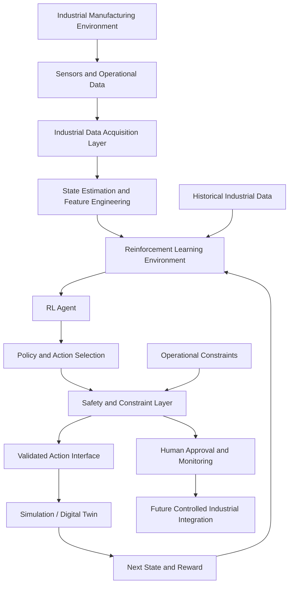
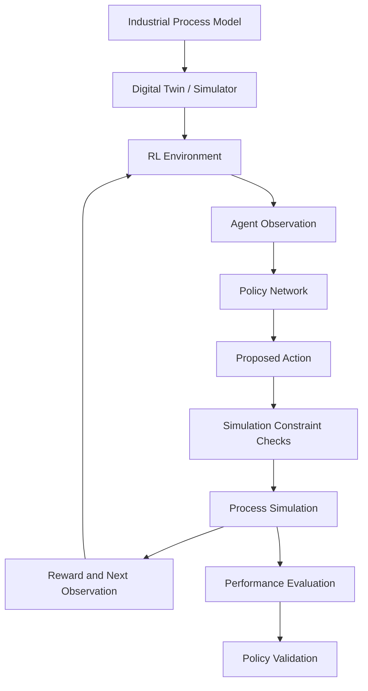
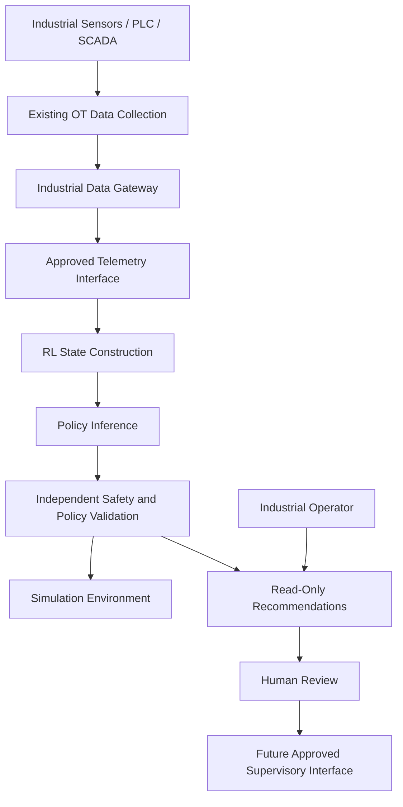

# Reinforcement Learning for Industrial Manufacturing: OT/ICS Intelligence and Control

[](#overview)
[](#industrial-domain)
[](#safe-reinforcement-learning)
[](#proposed-system-architecture)
[](LICENSE)

An experimental research project exploring the application of **Reinforcement Learning (RL), Deep Reinforcement Learning (DRL), and Safe Reinforcement Learning** to industrial manufacturing environments and Operational Technology (OT) / Industrial Control Systems (ICS).

The objective is to investigate how intelligent agents can learn optimal operational policies, adapt to changing manufacturing conditions, and improve industrial performance through interaction with simulated environments and controlled industrial data interfaces.

The project focuses on developing reinforcement-learning architectures capable of optimising manufacturing processes, improving equipment utilisation, supporting predictive maintenance, coordinating industrial operations, and making context-aware decisions under operational constraints.

The broader vision is to establish a foundation for intelligent, adaptive industrial systems that combine reinforcement learning, digital twins, industrial data, and safety-aware decision-making.

> **Project status:** Early-stage research and architectural development. This repository currently contains the initial project documentation and licence. RL implementations, industrial environments, digital-twin integrations, and experimental benchmarks are planned developments, not existing capabilities.

---

## Table of Contents

- [Overview](#overview)
- [Research Motivation](#research-motivation)
- [Research Objectives](#research-objectives)
- [Industrial Domain](#industrial-domain)
- [Why Reinforcement Learning for OT/ICS?](#why-reinforcement-learning-for-otics)
- [Fundamental Reinforcement Learning Concepts](#fundamental-reinforcement-learning-concepts)
- [Proposed System Architecture](#proposed-system-architecture)
- [Reinforcement Learning Algorithms](#reinforcement-learning-algorithms)
- [Industrial Applications](#industrial-applications)
- [Safe Reinforcement Learning](#safe-reinforcement-learning)
- [Digital Twins and Simulation](#digital-twins-and-simulation)
- [OT/ICS Integration](#otics-integration)
- [Agent Training and Deployment Pipeline](#agent-training-and-deployment-pipeline)
- [Evaluation Framework](#evaluation-framework)
- [Technology Stack](#technology-stack)
- [Getting Started](#getting-started)
- [Proposed Repository Structure](#proposed-repository-structure)
- [Development Roadmap](#development-roadmap)
- [Research References](#research-references)
- [Contributing](#contributing)
- [License](#license)

---

## Overview

Industrial manufacturing systems operate in complex environments where production performance depends on numerous interconnected factors.

These include equipment condition, operating parameters, production schedules, material availability, energy consumption, machine utilisation, and environmental conditions.

Traditional industrial control systems primarily rely on deterministic control algorithms, predefined rules, mathematical models, and operator-configured parameters.

Although these approaches remain essential for reliable industrial operation, increasingly complex manufacturing environments create opportunities for adaptive optimisation and data-driven decision-making.

Reinforcement Learning offers a different approach.

Rather than relying exclusively on predefined rules, an RL agent learns a policy through interaction with an environment. It receives observations, selects actions, and evaluates the consequences of those actions through reward signals.

With an appropriately designed environment, this process can enable an agent to learn policies that optimise long-term operational objectives.

This project investigates how these capabilities can be applied to industrial manufacturing environments.

### Core research areas

- Deep Reinforcement Learning (DRL).
- Safe and Constrained Reinforcement Learning.
- Industrial Process Optimisation.
- Intelligent Manufacturing.
- Digital Twin-Based Training.
- Industrial Decision-Making.
- Multi-Agent Reinforcement Learning (MARL).
- Predictive Maintenance.
- Energy and Resource Optimisation.
- OT/ICS Integration.

The primary objective is not to replace traditional industrial control systems, but to investigate how reinforcement-learning-based intelligence can complement existing industrial architectures.

---

## Research Motivation

Manufacturing environments are characterised by changing operational conditions, complex dependencies, and competing optimisation objectives.

For example, a production facility may need to maximise throughput while simultaneously minimising energy consumption, reducing equipment degradation, maintaining product quality, and avoiding unexpected downtime.

These objectives can conflict.

Increasing machine operating speed might improve production throughput but increase energy consumption or mechanical wear.

Reducing operating costs might require changing production schedules, machine utilisation, or maintenance strategies.

An optimisation strategy that performs well under one operating condition may not necessarily remain effective when conditions change.

This creates an opportunity to investigate reinforcement learning as a framework for sequential decision-making under uncertainty.

### The central research question

**How can reinforcement-learning agents learn, optimise, and adapt industrial operating policies while respecting the safety, reliability, cybersecurity, and operational constraints of real manufacturing environments?**

To investigate this question, the project aims to combine:

1. Reinforcement-learning algorithms.
2. Industrial process modelling.
3. Digital twin and simulation environments.
4. Industrial telemetry and historical datasets.
5. Safety-constrained policy optimisation.
6. Controlled OT/ICS integration.
7. Quantitative performance evaluation.

---

## Research Objectives

### 1. Develop industrial reinforcement-learning agents

Investigate RL architectures capable of learning policies for industrial manufacturing applications.

### 2. Optimise industrial operations

Explore how RL can improve production throughput, machine utilisation, process efficiency, and resource consumption.

### 3. Investigate adaptive decision-making

Develop policies that respond to changing environmental conditions and operational requirements.

### 4. Establish simulation-based training

Build controlled environments where agents can learn and be evaluated without exposing physical manufacturing equipment to unsafe exploration.

### 5. Integrate operational constraints

Investigate how safety boundaries, equipment limitations, operational rules, and process constraints can be incorporated into reinforcement-learning architectures.

### 6. Explore multi-agent industrial intelligence

Investigate whether multiple specialised RL agents can coordinate decisions across interconnected machines, production lines, or manufacturing processes.

### 7. Investigate sim-to-real transfer

Study how policies developed in simulation can be validated and potentially transferred to real industrial environments.

---

## Industrial Domain

The proposed framework targets manufacturing environments that combine industrial automation, process monitoring, production management, and intelligent optimisation.

| Industrial system | Function | Potential reinforcement-learning application |
|---|---|---|
| PLC | Machine and process control | Supervisory policy recommendations through validated interfaces |
| SCADA | Supervisory monitoring | Process optimisation and operational decision support |
| DCS | Distributed process control | Coordination and high-level process optimisation |
| MES | Production execution | Production scheduling and resource allocation |
| IIoT | Industrial sensing | Adaptive policies using sensor observations |
| Industrial robots | Automated manufacturing operations | Motion and task optimisation in simulation |
| Manufacturing historians | Historical operational data | Offline RL and policy evaluation |
| Energy management systems | Energy consumption monitoring | Energy-aware operational policies |
| CMMS | Maintenance management | Maintenance scheduling optimisation |
| Digital twins | Virtual representation of industrial processes | Agent training, testing, and validation |

The proposed architecture is intended to work alongside existing industrial systems rather than replace their deterministic control and safety functions.

---

## Why Reinforcement Learning for OT/ICS?

Reinforcement learning is particularly interesting for industrial environments because many manufacturing problems involve sequential decisions.

An action may produce an immediate result while also affecting future production conditions.

For example, changing a process setting can affect immediate throughput, future equipment condition, product quality, and energy consumption.

This makes the problem fundamentally different from optimising a single isolated parameter.

### Potential advantages

**Adaptive optimisation**

RL agents can learn policies that respond to changing environmental conditions instead of relying exclusively on fixed decision rules.

**Long-term decision-making**

An RL agent can optimise cumulative performance across multiple time steps rather than considering only immediate outcomes.

**Complex operational dependencies**

RL can model sequential decision problems involving interactions between multiple machines, resources, and production processes.

**Simulation-driven experimentation**

Agents can be trained in virtual environments, enabling controlled experimentation without directly exploring unsafe actions on production equipment.

**Multi-objective optimisation**

Appropriate reward and constraint formulations can represent competing operational objectives, including productivity, quality, energy consumption, and equipment condition.

### Important limitations

RL is not automatically superior to classical control, model predictive control (MPC), or conventional optimisation.

It can require substantial training data and computational resources, be sensitive to reward design, and learn policies that exploit weaknesses in the simulation or reward function.

Its suitability must therefore be established through controlled comparisons against appropriate industrial baselines.

---

## Fundamental Reinforcement Learning Concepts

The project will examine the mathematical foundations of reinforcement learning and their applications to industrial processes.

### Markov Decision Process (MDP)

A standard reinforcement-learning problem can be represented as a Markov Decision Process:

\[
\mathcal{M}=(S,A,P,R,\gamma)
\]

Where:

- \(S\): State space representing the environment.
- \(A\): Action space available to the agent.
- \(P\): State-transition probability function.
- \(R\): Reward function.
- \(\gamma\): Discount factor determining the importance of future rewards.

The agent observes the environment, selects an action, and receives feedback from the resulting state transition.

The objective is to learn a policy that maximises expected cumulative reward:

\[
\pi^* =
\arg\max_{\pi}
\mathbb{E}_{\pi}
\left[
\sum_{t=0}^{T}\gamma^t r_t
\right]
\]

### Industrial state representation

For a manufacturing environment, a state vector might contain:

\[
s_t =
[
T_t,\,
P_t,\,
V_t,\,
E_t,\,
Q_t,\,
M_t
]
\]

Where, depending on the application:

- \(T_t\): Temperature measurements.
- \(P_t\): Pressure measurements.
- \(V_t\): Vibration indicators.
- \(E_t\): Energy consumption.
- \(Q_t\): Production or quality indicators.
- \(M_t\): Machine operating information.

These are illustrative variables. The actual state representation must be determined by the industrial process being modelled.

In practice, industrial processes may be partially observable. Sensor noise, missing measurements, communication delays, and unmeasured physical conditions can require a Partially Observable Markov Decision Process (POMDP) formulation.

### Action space

An action describes what the agent can request from the environment.

Potential simulated actions include:

- Selecting a machine operating mode.
- Choosing a production schedule.
- Recommending an operating setpoint.
- Allocating production resources.
- Adjusting an energy-management strategy.
- Selecting a maintenance scheduling decision.

The permissible action space must reflect physical and operational restrictions.

### Reward function

The reward function defines what the agent is optimising.

For example, a conceptual manufacturing reward might be:

\[
R_t =
w_1 Q_t
-w_2 E_t
-w_3 D_t
-w_4 C_t
\]

Where:

- \(Q_t\): Production or quality performance.
- \(E_t\): Energy consumption.
- \(D_t\): Downtime.
- \(C_t\): Operating or maintenance cost.
- \(w_i\): Application-specific weighting coefficients.

This is an illustrative objective, not a universal industrial reward function.

A critical research task is understanding how reward design affects learned behaviour and how to prevent reward exploitation.

Safety requirements must also be represented through explicit constraints and independent enforcement mechanisms, rather than relying exclusively on negative reward penalties.

---

## Proposed System Architecture

The proposed system separates the learning environment, RL policy, industrial data interfaces, and safety mechanisms.

### High-level architecture



*Conceptual research architecture. It does not represent an implemented or connected industrial control system.*

### 1. Industrial data acquisition

The data acquisition layer collects authorised information from industrial systems.

Potential sources include:

- Sensors and IIoT devices.
- SCADA monitoring.
- PLC-derived telemetry.
- Industrial historians.
- MES databases.
- Maintenance systems.
- Simulated industrial processes.

Data should be validated for quality, timestamps, missing values, and freshness before being used to construct observations.

### 2. State estimation and feature engineering

Raw industrial telemetry must be transformed into meaningful observations.

This layer can include:

- Sensor normalisation.
- Filtering and noise reduction.
- Feature extraction.
- Temporal aggregation.
- Equipment-state estimation.
- Anomaly indicators.
- Historical context.

### 3. Reinforcement-learning environment

The environment defines the relationship between agent actions and process outcomes.

It is responsible for:

- Providing observations.
- Validating actions.
- Applying process dynamics.
- Computing rewards.
- Enforcing environment constraints.
- Returning termination and truncation conditions.

### 4. RL agent

The agent learns a policy based on the interaction between observations, actions, and rewards.

Depending on the application, this component may use value-based, policy-gradient, actor-critic, or multi-agent reinforcement-learning architectures.

### 5. Safety and constraint layer

The safety layer independently evaluates actions before they can progress to any future industrial interface.

It should enforce:

- Permitted operating ranges.
- Equipment-specific restrictions.
- Action rate limits.
- Operational policies.
- Authorisation boundaries.
- Emergency and fallback behaviour.

### 6. Digital twin and simulation

The digital twin or simulated environment provides a controlled setting for policy learning, validation, and experimentation.

The initial training architecture should remain isolated from physical industrial control networks.

---

## Reinforcement Learning Algorithms

The project will investigate several RL algorithm families and their suitability for different manufacturing applications.

### 1. Deep Q-Network (DQN)

DQN combines Q-learning with deep neural networks to estimate the expected return of possible actions.

It is particularly suitable for environments with discrete action spaces.

Potential applications:

- Production scheduling decisions.
- Machine-mode selection in simulation.
- Resource allocation.
- Discrete maintenance planning.

The DQN objective is based on the temporal-difference target:

\[
y_t =
r_t+\gamma\max_{a'}Q_{\theta^-}(s_{t+1},a')
\]

Where \(\theta^-\) represents the parameters of the target network.

Reference: [Human-level control through deep reinforcement learning (2015)](https://doi.org/10.1038/nature14236).

### 2. Proximal Policy Optimization (PPO)

PPO is an actor-critic reinforcement-learning algorithm that uses a clipped surrogate objective to control policy updates.

It can be applied to discrete or continuous action spaces, depending on the policy architecture.

Potential applications:

- Simulated process optimisation.
- Continuous operating-parameter optimisation.
- Industrial scheduling.
- Adaptive supervisory policies.

Reference: [Proximal Policy Optimization Algorithms](https://arxiv.org/abs/1707.06347).

### 3. Soft Actor-Critic (SAC)

SAC is an off-policy actor-critic algorithm that incorporates an entropy objective to encourage exploration.

It is especially relevant for continuous-control problems.

Potential applications:

- Simulated process-parameter optimisation.
- Energy-management policies.
- Continuous machine operating decisions.
- Resource allocation with continuous action variables.

Reference: [Soft Actor-Critic Algorithms and Applications](https://arxiv.org/abs/1812.05905).

### 4. Twin Delayed Deep Deterministic Policy Gradient (TD3)

TD3 is an off-policy actor-critic algorithm designed to improve learning stability in continuous action spaces.

Potential applications:

- Continuous process optimisation.
- Simulated equipment-control policies.
- Industrial parameter optimisation.

Reference: [Addressing Function Approximation Error in Actor-Critic Methods](https://arxiv.org/abs/1802.09477).

### 5. Multi-Agent Reinforcement Learning (MARL)

Many industrial environments involve interconnected machines and production processes.

MARL investigates how multiple agents can learn coordinated policies.

Potential applications:

- Coordination between production lines.
- Distributed energy management.
- Multi-robot manufacturing.
- Resource allocation across manufacturing cells.
- Distributed production scheduling.

Relevant algorithm families include:

- Multi-Agent PPO (MAPPO).
- Multi-Agent Deep Deterministic Policy Gradient (MADDPG).
- QMIX.
- Independent Q-learning.

The choice depends on whether the environment is cooperative, competitive, centralised, or distributed.

### Algorithm comparison

| Algorithm | Learning approach | Action space | Potential industrial application |
|---|---|---|---|
| DQN | Value-based, off-policy | Discrete | Machine modes and scheduling |
| PPO | Policy-gradient, on-policy | Discrete and continuous | Supervisory optimisation |
| SAC | Actor-critic, off-policy | Continuous | Process and energy optimisation |
| TD3 | Actor-critic, off-policy | Continuous | Continuous process control experiments |
| MAPPO | Multi-agent actor-critic | Depends on policy | Coordinated production systems |
| QMIX | Multi-agent value-based | Discrete | Cooperative machine scheduling |

These algorithms represent candidate research directions. The project does not yet contain their implementations.

---

## Industrial Applications

The proposed framework investigates several potential applications of reinforcement learning in industrial manufacturing.

### 1. Production optimisation

An RL agent could learn to improve production performance by considering:

- Machine availability.
- Product demand.
- Production-cycle times.
- Resource utilisation.
- Bottleneck conditions.
- Scheduling constraints.

The objective could be to maximise production throughput while respecting quality and operating constraints.

### 2. Predictive maintenance and maintenance scheduling

Reinforcement learning could be investigated for selecting maintenance policies based on equipment condition and operational context.

Potential inputs include:

- Vibration measurements.
- Temperature trends.
- Operating hours.
- Historical failures.
- Maintenance records.
- Equipment degradation indicators.

Potential decisions include maintenance timing, inspection priorities, and resource allocation.

Importantly, anomaly detection or remaining-useful-life estimation alone is not an RL problem. RL becomes relevant when the system learns sequential maintenance decisions and their long-term consequences.

### 3. Energy optimisation

Manufacturing facilities often operate under competing production and energy objectives.

A suitable RL environment could investigate:

- Energy-aware production scheduling.
- Load management.
- Equipment operating strategies.
- Resource allocation.
- Energy consumption under variable demand.

The objective is to improve energy efficiency without violating production or process requirements.

### 4. Process optimisation

For suitable simulated industrial processes, RL could investigate operating policies involving variables such as:

- Temperature.
- Pressure.
- Flow rate.
- Equipment speed.
- Process timing.
- Resource utilisation.

The policy must operate within validated process boundaries and be compared against established control approaches.

### 5. Industrial robotics

Reinforcement learning can also be investigated in manufacturing robotics.

Potential areas include:

- Robot motion planning in simulation.
- Trajectory optimisation.
- Task allocation.
- Multi-robot coordination.
- Adaptation to changing work-cell conditions.

Physical robot deployment requires separate safety engineering and validation.

### 6. Production scheduling

An RL agent could learn scheduling policies based on machine availability, deadlines, job priorities, and resource limitations.

This is particularly interesting for complex manufacturing environments where operational conditions change continuously.

---

## Safe Reinforcement Learning

Safety is a fundamental requirement of any reinforcement-learning approach targeting industrial control.

Traditional RL algorithms may explore actions that result in unsafe or undesirable states during training.

This is acceptable in some abstract simulation environments, but it is not an acceptable default approach for physical industrial infrastructure.

The project therefore prioritises **Safe Reinforcement Learning (Safe RL)**.

### Why conventional RL is insufficient

A reward-based objective does not inherently guarantee that the agent will avoid unsafe behaviour.

For example, an agent trying to maximise production throughput could discover a policy that increases machine speed beyond acceptable operating limits if the reward function does not adequately represent those constraints.

Even when unsafe actions receive negative rewards, the exploration process may still encounter unsafe states.

This motivates the use of explicit constraint enforcement.

### 1. Constrained Reinforcement Learning

Instead of optimising reward alone, a constrained RL formulation can be written as:

\[
\max_{\pi}
\mathbb{E}_{\pi}
\left[
\sum_{t=0}^{T}\gamma^t r_t
\right]
\]

Subject to:

\[
\mathbb{E}_{\pi}
\left[
\sum_{t=0}^{T}\gamma^t c_{j,t}
\right]
\leq d_j
\]

Where:

- \(r_t\) is the operational reward.
- \(c_{j,t}\) is a constraint cost.
- \(d_j\) is the permitted constraint budget.

Possible constraints include equipment operating ranges, resource limits, and process-specific restrictions.

The precise formulation must reflect the physical process and its safety requirements.

### 2. Action shielding

A safety shield can evaluate a proposed action before execution.

If an action violates a specified safety condition, the shield blocks it or substitutes a predefined safe response.

The shield must be implemented independently of the learned policy.

Its guarantees depend on the accuracy and completeness of the underlying process and safety model.

### 3. Safe exploration

Initial training should take place in simulation or other controlled environments.

Potential techniques include:

- Restricted action spaces.
- Safe initialisation.
- Constrained exploration.
- Model-based safety evaluation.
- Offline reinforcement learning.
- Runtime action validation.
- Conservative policy updates.

### 4. Human supervision

Potential industrial actions should pass through an appropriate approval process.

The agent must not be able to disable, modify, or bypass industrial safety mechanisms.

### 5. Separation from deterministic control

The RL architecture should complement rather than replace:

- PLC control logic.
- PID controllers.
- Safety Instrumented Systems (SIS).
- Emergency-stop mechanisms.
- Deterministic interlocks.
- Certified machine safety functions.

A suitable initial architecture is to train policies in simulation and evaluate them as supervisory decision-support components, without allowing direct control of physical equipment.

**Safety principle:** Never perform uncontrolled online exploration against live industrial processes.

---

## Digital Twins and Simulation

Digital twins and simulation environments are central to the proposed research architecture.

A reinforcement-learning agent needs an environment in which it can repeatedly observe states, perform actions, and evaluate resulting outcomes.

For industrial applications, using physical equipment for unrestricted policy exploration would introduce unacceptable operational risks.

Simulation provides an environment in which training can take place under controlled conditions.

### Why digital twins?

A digital twin or sufficiently representative simulator can provide:

- Virtual representations of industrial processes.
- Simulated machine dynamics.
- Equipment operating constraints.
- Synthetic sensor observations.
- Production scenarios.
- Fault and disturbance scenarios.
- Repeatable experimental conditions.

### Proposed simulation workflow



### Candidate simulation environments

| Platform | Potential use |
|---|---|
| [Gymnasium](https://gymnasium.farama.org/) | Defining standard RL environments |
| [Stable-Baselines3](https://stable-baselines3.readthedocs.io/) | Baseline RL implementations |
| [Ray RLlib](https://docs.ray.io/en/latest/rllib/index.html) | Scalable RL and multi-agent experiments |
| [PettingZoo](https://pettingzoo.farama.org/) | Multi-agent simulation interfaces |
| [MATLAB Simulink](https://www.mathworks.com/products/simulink.html) | Dynamic-system modelling and control simulation |
| [Factory I/O](https://factoryio.com/) | Factory automation simulation |
| [CARLA](https://carla.org/) | Robotics and autonomous-system simulation, where relevant |

The final simulator should be selected based on the manufacturing process, model fidelity, control interface, and availability of representative system dynamics.

### Sim-to-real transfer

A major challenge in industrial RL is transferring a policy learned in a simulator to a real environment.

A simulated process will never perfectly reproduce every physical characteristic of an actual manufacturing facility.

Differences may arise from:

- Sensor noise.
- Mechanical wear.
- Actuator delays.
- Communication latency.
- Unmodelled dynamics.
- Environmental conditions.
- Equipment ageing.

The project should therefore investigate:

- Domain randomisation.
- System identification.
- Model calibration.
- Robust policy optimisation.
- Offline policy evaluation.
- Controlled deployment validation.

Simulation performance must not be treated as evidence of real-world safety.

---

## OT/ICS Integration

Industrial integration should be designed around secure and validated data interfaces.

The RL agent should not communicate directly with PLCs or industrial control networks during initial development.

Instead, the system should use isolated simulation environments, historical datasets, and controlled integration gateways.

### Potential integration technologies

| Technology | Purpose |
|---|---|
| OPC UA | Industrial interoperability and access to approved process information |
| MQTT | Industrial telemetry and event distribution |
| Modbus TCP | Potential integration through controlled industrial gateways |
| REST APIs | Enterprise and industrial application integration |
| SQL | Access to structured industrial datasets |
| Industrial historians | Historical process and equipment data |
| MES | Production and manufacturing information |

### Proposed integration architecture



Any future action interface must have separate authorisation, validation, and approval mechanisms.

### Industrial cybersecurity

The system should adopt:

- Network segmentation.
- Least-privilege access.
- Secure authentication.
- Explicit authorisation.
- Data integrity validation.
- Audit logging.
- Independent safety enforcement.
- Secure deployment and update mechanisms.

Relevant guidance includes:

- [NIST SP 800-82 – Guide to Operational Technology Security](https://csrc.nist.gov/pubs/sp/800/82/r3/final).
- [ISA/IEC 62443 – Industrial Automation and Control Systems Security](https://www.isa.org/standards-and-publications/isa-standards/isa-iec-62443-series-of-standards).
- [MITRE ATT&CK for ICS](https://attack.mitre.org/matrices/ics/).

The project does not currently claim certification or compliance with these frameworks.

---

## Agent Training and Deployment Pipeline

The proposed development workflow separates training, evaluation, and future deployment.

### Stage 1: Environment development

Define the process model, observation space, action space, reward function, and operational constraints.

### Stage 2: Baseline policy development

Implement simple baseline strategies and classical control approaches to establish meaningful performance comparisons.

### Stage 3: RL training

Train candidate algorithms using the simulated industrial environment.

Track reward, constraint violations, convergence, and computational cost.

### Stage 4: Policy evaluation

Evaluate the trained policy on separate scenarios, including unseen conditions and disturbances.

### Stage 5: Robustness assessment

Investigate the effects of sensor noise, parameter changes, equipment failures, and delayed observations.

### Stage 6: Deployment-readiness assessment

Assess whether the policy is suitable for further testing in an isolated environment or as a non-binding decision-support system.

Any subsequent physical-system integration would require independent engineering, cybersecurity, and safety approval.

---

## Evaluation Framework

The project should evaluate RL agents using operational metrics, algorithmic metrics, and safety indicators.

A high cumulative reward alone is insufficient to establish that an agent is useful or safe in an industrial setting.

### Performance evaluation

| Category | Metrics |
|---|---|
| Production efficiency | Throughput, cycle time, production rate |
| Equipment utilisation | Availability, utilisation, downtime |
| Energy efficiency | Energy consumption per unit produced |
| Product quality | Defect rate, rejection rate, yield |
| Maintenance | Maintenance frequency, downtime, degradation indicators |
| Learning performance | Cumulative reward, convergence, sample efficiency |
| Computational performance | Training time, inference latency, memory usage |
| Robustness | Performance under disturbances and unseen scenarios |
| Safety | Constraint violations, unsafe-action attempts, intervention frequency |
| Reliability | Failure rate, policy stability, recovery behaviour |

### Algorithmic evaluation

Additional analysis should include:

- Training reward curves.
- Evaluation reward distributions.
- Policy entropy.
- Value-function estimation quality where applicable.
- Gradient and optimisation stability.
- Sensitivity to hyperparameters.
- Sample efficiency.
- Computational resource consumption.

### Baseline comparison

RL policies should be compared against relevant alternatives, which may include:

- Fixed operational rules.
- Existing control strategies.
- PID controllers for appropriate control problems.
- Model Predictive Control (MPC).
- Classical scheduling and optimisation algorithms.
- Other reinforcement-learning algorithms.

Comparisons should use matched operating conditions, constraints, and evaluation scenarios.

---

## Technology Stack

The following technologies are potential components of the future implementation.

| Technology | Application |
|---|---|
| Python | Primary development language |
| PyTorch | Deep-learning models and RL architectures |
| Gymnasium | Environment interface |
| Stable-Baselines3 | Baseline RL algorithms |
| Ray RLlib | Scalable and distributed reinforcement learning |
| PettingZoo | Multi-agent environments |
| NumPy | Numerical computation |
| Pandas | Industrial data processing |
| SciPy | Scientific computation and optimisation |
| MATLAB/Simulink | Process modelling and control simulation |
| OPC UA | Industrial connectivity |
| MQTT | Industrial telemetry |
| Docker | Reproducible environments and packaging |
| Weights & Biases / TensorBoard | Experiment tracking |

These are candidate technologies, not confirmed dependencies of the current repository.

---

## Getting Started

### Repository status

The current repository contains the initial README and MIT licence.

Training implementations, industrial simulation environments, datasets, configuration files, and executable experiments have not yet been added.

### Clone the repository

```bash
git clone https://github.com/valid999/RL_Model_OT-ICS.git
cd RL_Model_OT-ICS
```

### Future development environment

Once the initial implementation is added, a reproducible Python environment will be provided.

The planned environment will include:

- Python.
- PyTorch.
- Gymnasium.
- An RL algorithm library.
- Scientific computing dependencies.
- Simulation and evaluation utilities.

There are currently no verified repository-specific installation or training commands.

---

## Proposed Repository Structure

The following structure describes a potential organisation for the future implementation.

```text
RL_Model_OT-ICS/
│
├── README.md
├── LICENSE
├── requirements.txt
├── .gitignore
│
├── configs/
│   ├── environment.yaml
│   ├── training.yaml
│   └── evaluation.yaml
│
├── environments/
│   ├── industrial_process/
│   ├── manufacturing_line/
│   ├── energy_management/
│   └── digital_twin/
│
├── agents/
│   ├── dqn/
│   ├── ppo/
│   ├── sac/
│   ├── td3/
│   └── multi_agent/
│
├── algorithms/
│   ├── replay_buffer/
│   ├── policy_networks/
│   ├── value_networks/
│   └── training/
│
├── safety/
│   ├── constraints/
│   ├── action_shield/
│   ├── safe_exploration/
│   └── policy_validation/
│
├── industrial_data/
│   ├── preprocessing/
│   ├── telemetry/
│   ├── historical_data/
│   └── feature_engineering/
│
├── integrations/
│   ├── opcua/
│   ├── mqtt/
│   └── historians/
│
├── experiments/
│   ├── baseline_control/
│   ├── algorithm_comparison/
│   └── ablation_studies/
│
├── evaluation/
│   ├── performance/
│   ├── robustness/
│   └── safety/
│
├── results/
│
├── notebooks/
│
├── tests/
│
└── docs/
    ├── architecture.md
    ├── methodology.md
    ├── safety_framework.md
    └── deployment.md
```

This is a proposed structure and does not represent existing repository files.

---

## Development Roadmap

### Phase 1 — Reinforcement-learning foundations

- [ ] Establish the mathematical framework.
- [ ] Define industrial RL problem formulations.
- [ ] Implement a basic Gymnasium environment.
- [ ] Establish baseline policies.
- [ ] Add environment tests and reproducibility controls.

### Phase 2 — Deep reinforcement learning

- [ ] Implement DQN for discrete industrial decisions.
- [ ] Implement PPO for policy optimisation.
- [ ] Investigate SAC for continuous-action problems.
- [ ] Investigate TD3 for continuous-control experiments.
- [ ] Compare algorithms using controlled environments.

### Phase 3 — Industrial simulation

- [ ] Develop a simulated manufacturing process.
- [ ] Define equipment constraints.
- [ ] Integrate synthetic industrial telemetry.
- [ ] Introduce production disturbances and failure scenarios.
- [ ] Establish reproducible simulation benchmarks.

### Phase 4 — Safe reinforcement learning

- [ ] Implement explicit action constraints.
- [ ] Investigate constrained policy optimisation.
- [ ] Develop an independent action-shielding mechanism.
- [ ] Investigate conservative and offline RL.
- [ ] Evaluate constraint violations and recovery behaviour.

### Phase 5 — Industrial intelligence

- [ ] Investigate production optimisation.
- [ ] Explore predictive maintenance policies.
- [ ] Develop energy-management experiments.
- [ ] Investigate manufacturing scheduling.
- [ ] Explore multi-agent industrial coordination.

### Phase 6 — OT/ICS integration

- [ ] Develop industrial data adapters.
- [ ] Investigate OPC UA read-only integration.
- [ ] Investigate MQTT telemetry integration.
- [ ] Develop industrial state-estimation pipelines.
- [ ] Establish isolated policy-evaluation interfaces.

### Phase 7 — Deployment research

- [ ] Investigate sim-to-real transfer.
- [ ] Evaluate robustness against process uncertainty.
- [ ] Benchmark edge-inference performance.
- [ ] Conduct cybersecurity and safety assessments.
- [ ] Establish requirements for controlled industrial pilot testing.

---

## Research References

The following research and technical resources provide a foundation for the project.

### Reinforcement learning

1. **Mnih et al. (2015)** — *Human-level control through deep reinforcement learning.*

   Foundational work introducing Deep Q-Networks for learning control policies from high-dimensional observations.

   [Nature](https://doi.org/10.1038/nature14236)

2. **Schulman et al. (2017)** — *Proximal Policy Optimization Algorithms.*

   Introduces PPO, a policy-gradient method widely used in modern RL applications.

   [arXiv:1707.06347](https://arxiv.org/abs/1707.06347)

3. **Haarnoja et al. (2018)** — *Soft Actor-Critic: Off-Policy Maximum Entropy Deep Reinforcement Learning with a Stochastic Actor.*

   Introduces the SAC framework for continuous-control problems.

   [arXiv:1801.01290](https://arxiv.org/abs/1801.01290)

4. **Fujimoto et al. (2018)** — *Addressing Function Approximation Error in Actor-Critic Methods.*

   Introduces TD3 to address overestimation issues in actor-critic reinforcement learning.

   [arXiv:1802.09477](https://arxiv.org/abs/1802.09477)

### Reinforcement learning in industry

5. **Nian, Liu and Huang (2020)** — *A review on reinforcement learning: Introduction and applications in industrial process control.*

   Reviews reinforcement learning applications in industrial process control and compares RL with traditional process-control methods.

   [Computers & Chemical Engineering](https://doi.org/10.1016/j.compchemeng.2020.106886)

6. **Ibrahim et al. (2024)** — *Reinforcement Learning in Process Industries: Review and Perspective.*

   Reviews RL methods and applications across process-industry control, monitoring, optimisation, planning, and scheduling.

   [IEEE/CAA Journal of Automatica Sinica](https://doi.org/10.1109/JAS.2024.124227)

7. **Mayerhoff and Schmidt (2026)** — *Reinforcement learning for autonomous production planning and control: A systematic literature review.*

   Reviews research on RL for production planning and control, highlighting simulation-centric evaluation and challenges involving real-world validation and sim-to-real transfer.

   [Journal of Manufacturing Systems](https://doi.org/10.1016/j.jmsy.2026.03.023)

### Safe reinforcement learning

8. **Shields for Safe Reinforcement Learning.**

   Discusses runtime action shielding and safety enforcement in reinforcement-learning systems.

   [Communications of the ACM](https://doi.org/10.1145/3715958)

### Industrial cybersecurity

9. **NIST SP 800-82 Rev. 3 — Guide to Operational Technology Security.**

   Covers OT architectures, threats, vulnerabilities, and security countermeasures, with consideration for operational reliability and safety.

   [NIST publication](https://csrc.nist.gov/pubs/sp/800/82/r3/final)

10. **ISA/IEC 62443 — Industrial Automation and Control Systems Security.**

    Provides a framework of industrial cybersecurity standards.

    [ISA official resources](https://www.isa.org/standards-and-publications/isa-standards/isa-iec-62443-series-of-standards)

---

## Contributing

Contributions are welcome from researchers, developers, and engineers working in:

- Reinforcement Learning and Deep Reinforcement Learning.
- Industrial AI and intelligent manufacturing.
- OT/ICS and industrial automation.
- Process control and optimisation.
- Digital twins and simulation.
- Robotics and autonomous systems.
- Industrial cybersecurity.
- Safe and constrained reinforcement learning.

Potential contributions include algorithm implementations, industrial simulation environments, benchmark datasets, safety mechanisms, evaluation tools, and technical documentation.

For significant contributions, please open an issue describing the proposed changes before submitting a pull request.

All reported experimental results should include sufficient information about the environment, algorithm, configuration, hardware, and evaluation methodology to support reproducibility.

---

## License

This project is distributed under the MIT License. See the [LICENSE](LICENSE) file for details.

---

## Author and Project

Maintained by [valid999](https://github.com/valid999).

**Project:** RL Model for OT/ICS

**Repository:** [github.com/valid999/RL_Model_OT-ICS](https://github.com/valid999/RL_Model_OT-ICS)

**Research direction:** Reinforcement Learning, Safe RL, Industrial Manufacturing, OT/ICS, Digital Twins, Process Optimisation, and Intelligent Industrial Control.

---

*Towards adaptive and intelligent manufacturing: developing reinforcement-learning systems that learn from industrial environments, optimise operational decisions, and respect the constraints of safety-critical infrastructure.*
